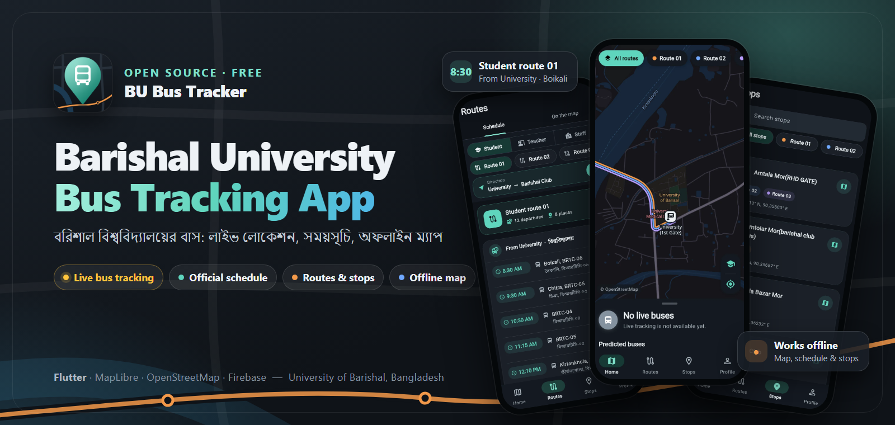
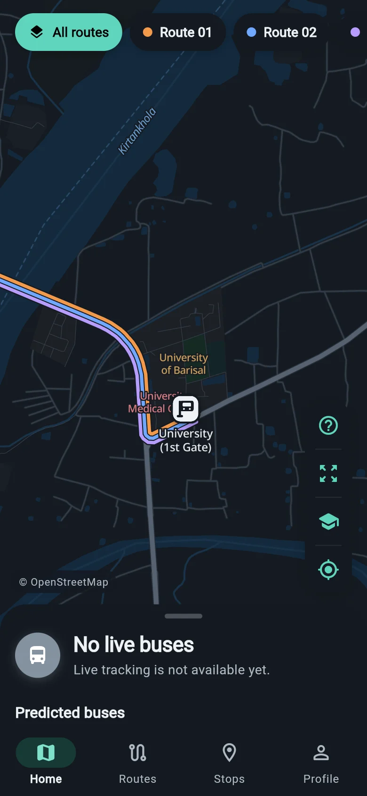
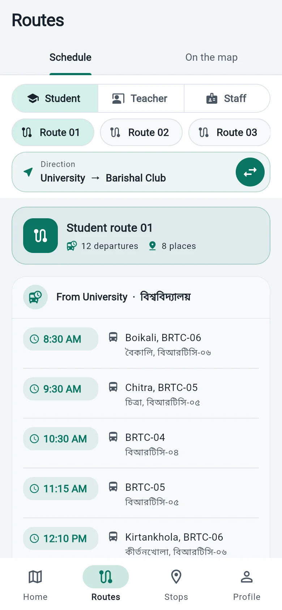
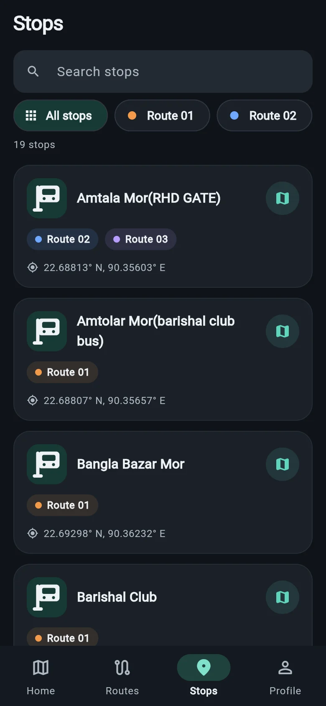
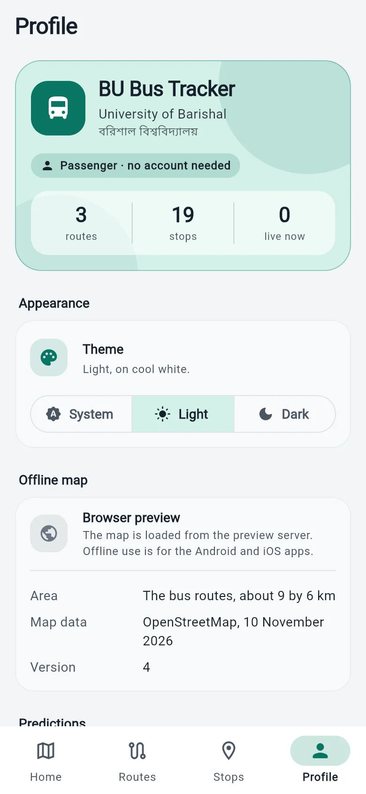

<p align="center">
  <a href="https://yeamin-talukder.github.io/Barishal-University-Bus-Tracking-App/">
    
  </a>
</p>

<div align="center">

# Barishal University Bus Tracking App

**BU Bus Tracker: live bus tracking, the official bus schedule and an offline map for University of Barishal students, teachers and staff.**

**বরিশাল বিশ্ববিদ্যালয় বাস ট্র্যাকার: ববির বাসের লাইভ লোকেশন, বাসের সময়সূচি আর অফলাইন ম্যাপ, এক অ্যাপে।**

[](https://github.com/Yeamin-Talukder/Barishal-University-Bus-Tracking-App/releases)
[](https://github.com/Yeamin-Talukder/Barishal-University-Bus-Tracking-App/releases/latest)
[](https://github.com/Yeamin-Talukder/Barishal-University-Bus-Tracking-App)
[](https://github.com/Yeamin-Talukder/Barishal-University-Bus-Tracking-App/stargazers)
[](https://github.com/Yeamin-Talukder/Barishal-University-Bus-Tracking-App/commits/main)
[](LICENSE)

[](https://flutter.dev)
[](#download)
[](https://maplibre.org)
[](https://firebase.google.com)

[**⬇ Download for Android**](https://github.com/Yeamin-Talukder/Barishal-University-Bus-Tracking-App/releases/latest) ·
[**Website**](https://yeamin-talukder.github.io/Barishal-University-Bus-Tracking-App/) ·
[Features](#features) · [Screenshots](#screenshots) · [Roadmap](#roadmap) · [FAQ](#faq)

</div>

---

## About the project

**Barishal University Bus Tracking App** (BU Bus Tracker) is a free, open-source mobile app for the buses of the **University of Barishal (বরিশাল বিশ্ববিদ্যালয়, BU / ববি)** in Barishal, Bangladesh. It answers the question every student asks at the bus stop: *where is my bus, and when does it come?*

- See the **University of Barishal bus schedule** for student, teacher and staff routes, in Bangla and English.
- Find every **bus stop and route** around the campus, Rupatoli, Kathaltola, Notun Bazar and the rest of the city on a clean map.
- Follow **university buses in real time** as drivers share their position during a trip (in testing).
- Use the **offline map of Barishal** with no internet connection.
- **Try it without a bus:** the app can run pretend buses on your own phone, so you can see how tracking looks before real buses are sharing.

No account is needed to use the app. It is built with Flutter, MapLibre and OpenStreetMap, with Firebase for the live data.

> The project is in **early access**: the schedule, stops, routes and offline map work today; live tracking, driver mode and arrival times are built and being tested on real buses. Progress is tracked in [DEVELOPMENT.md](DEVELOPMENT.md).

## Download

| Platform | Status | Get it |
|---|---|---|
| **Android** 7.0 or newer | Early access | [Latest APK from GitHub Releases](https://github.com/Yeamin-Talukder/Barishal-University-Bus-Tracking-App/releases/latest) |
| **iPhone** (iOS 15.5+) | Planned | Needs a Mac to build and test |

**Which file:** almost every Android phone from the last several years needs the `arm64` APK. The `armv7` APK is for older 32-bit phones; if the `arm64` one will not install, use that.

**Installing the APK:** download it on your Android phone, open the file, allow *Install unknown apps* for your browser if asked, then tap **Install**. The offline map sets itself up on first launch. Download the app only from this repository or the [project website](https://yeamin-talukder.github.io/Barishal-University-Bus-Tracking-App/), and compare the SHA-256 checksum shown on the release if you want to be sure the file is untouched.

> **Early-access signing:** these builds are signed with a development key, not the final release key. When the app moves to its final key (for Google Play), this version will have to be uninstalled before the new one can be installed. Nothing you do in the app as a passenger is lost: it keeps no account for you.

## Features

| | Feature | Status |
|---|---|---|
| 🗺️ | **Offline map of Barishal**: streets, buildings, river and landmarks along the bus routes, stored on the phone, light and dark, with 3D buildings | ✅ Available, tested in airplane mode |
| 🕒 | **Official bus schedule**: 11 timetables and 101 departures for students, teachers and staff, in Bangla and English | ✅ Available |
| 📍 | **Routes and stops**: student routes 01–03 on the map with their stops; search stops by name, filter them by route, and see which routes call there | ✅ Available |
| 🔁 | **Schedule by direction**: switch a route between "University → city" and "city → University" and see that direction's departures and stops in order | ✅ Available |
| 🧭 | **Map key and quick views**: one tap for what each marker means, for every route at once, for the university, or for where you are | ✅ Available |
| 🧪 | **Test the system**: run pretend buses on your own phone to see the app at work. Nothing is sent to the server, nobody else sees them, and each is named TEST | ✅ Available |
| 👤 | **No account for passengers**: only drivers and transport office staff sign in, with Google | ✅ Available |
| 🛠️ | **Transport office tools**: manage stops, the schedule, buses, staff roles and announcements from inside the app | ✅ Available |
| 🚌 | **Live bus tracking**: buses glide along their route line in real time. Follow a bus and the map turns to face the way it is going, like a navigation app | 🧪 In testing |
| 📱 | **Driver mode**: the driver's phone shares the bus's GPS during a trip, also in the background | 🧪 In testing |
| ⏱️ | **Arrival times**: minutes until a bus reaches your stop, measured along the real route, with which way each bus is going and how far away it is | 🧪 In testing |
| 🔮 | **Predictions**: where a bus probably is when live data is missing, from the timetable and from where it was last seen. The app learns real travel speeds from live buses and keeps them on the phone, so predictions work offline. Always labelled as a prediction, never shown as live | 🧪 In testing |
| 📢 | **Announcements** from the transport office, in the app | 🧪 In testing |
| 🔔 | Push notifications · 🍏 iPhone version · ▶️ Google Play | 🗓️ Planned |

## Screenshots

<p align="center">
  
  
  
  
</p>

<p align="center"><sub>Real screenshots of the current version. Map data © OpenStreetMap contributors.</sub></p>

## How live tracking works

1. **The driver starts the trip** in driver mode. The phone shares the bus's position about every five seconds until the trip ends.
2. **The cloud checks it.** Firebase security rules accept a position only from the driver assigned to that bus's active trip, at most once a second.
3. **Passengers' phones show the bus** gliding along its route line, with its next stop and an arrival estimate. When the signal drops, a clearly labelled prediction takes over.

A position that is not fresh is never shown as live: a bus is marked *Live*, *Delayed* or *Offline* by the age of its last report, and a predicted bus has its own dashed marker and the word *Predicted*.

## Roadmap

- [x] Offline vector map of the bus routes (OpenStreetMap, PMTiles, MapLibre)
- [x] Official schedule: 11 timetables, 101 departures
- [x] Routes 01–03 and their stops on the map
- [x] Admin tools: stops, schedule, buses, people, announcements
- [x] Driver mode and live tracking (built, testing on real buses)
- [x] Arrival times and offline predictions (built, testing)
- [x] On-device test mode, map key, heading-up following, schedule by direction
- [ ] Trial runs on real university buses
- [ ] Push notifications
- [ ] Routes 04–08 on the map (the schedule lists no stops for them yet)
- [ ] Final release signing key, then a Google Play listing
- [ ] iPhone version

## Tech stack

| Area | Technology |
|---|---|
| App | [Flutter](https://flutter.dev) 3.47, Dart 3.13, Material 3 (Teal Mint theme) |
| State and navigation | Riverpod 3, GoRouter |
| Map | [MapLibre](https://maplibre.org) (`maplibre_gl`) with a PMTiles archive of [OpenStreetMap](https://www.openstreetmap.org) data from [Protomaps](https://protomaps.com) |
| Location | Geolocator, with a foreground service for driver mode on Android |
| Backend | Firebase: Authentication (Google sign-in), Cloud Firestore, Realtime Database, security rules with tests |
| Website | Static HTML, CSS and JavaScript in [`website/`](website/), published with GitHub Pages |

## Getting started (developers)

Requirements: Flutter 3.47+, Android Studio with the Android SDK and **JDK 21 or newer** (minimum Android 7.0 / API 24); a Mac with Xcode for iOS (iOS 15.5+).

```bash
git clone https://github.com/Yeamin-Talukder/Barishal-University-Bus-Tracking-App.git
cd Barishal-University-Bus-Tracking-App
flutter pub get
```

**Firebase:** the project's own Firebase configuration is not in the repository. Connect your own Firebase project before building for Android or iOS:

```bash
dart pub global activate flutterfire_cli
flutterfire configure
```

This writes `lib/firebase_options.dart`, `android/app/google-services.json` and `ios/Runner/GoogleService-Info.plist`. Without it, the committed placeholder `lib/firebase_options.dart` lets the app start with the map and the built-in schedule, and the Profile tab says the tracking service is not set up. Details: [FIREBASE_SETUP.md](FIREBASE_SETUP.md).

```bash
flutter run
```

Browser preview (development only; the map needs a server that supports range requests):

```bash
flutter build web
python tools/dev/serve_web.py
```

Checks:

```bash
flutter analyze
flutter test
```

Security-rule tests on the local Firebase emulators (Firebase CLI, Node and Java 21+):

```bash
firebase emulators:exec --only firestore,database --project demo-bu-bus-tracker "npm --prefix firebase/test test"
```

## Project structure

```
lib/                 the Flutter app (core/, data/, features/, shared/)
assets/              offline map, map styles, schedule, icons
firebase/            Firestore and Realtime Database rules, functions, rule tests
tools/               map, data, icon and developer scripts
test/                unit and widget tests
website/             the project website (GitHub Pages)
demo/                early HTML map prototypes, not part of the app
```

## Documentation

- [DEVELOPMENT.md](DEVELOPMENT.md): progress, decisions, known issues, verification
- [FIREBASE_SETUP.md](FIREBASE_SETUP.md): Firebase project, security rules, deployment
- [OFFLINE_MAP.md](OFFLINE_MAP.md): map data, licensing, rebuilding the map
- [docs/TRANSPORT_DATA_FORMAT.md](docs/TRANSPORT_DATA_FORMAT.md): adding routes and stops, changing the schedule
- [website/README.md](website/README.md): the website, releases and SEO
- [CONTRIBUTING.md](CONTRIBUTING.md) · [SECURITY.md](SECURITY.md)

## FAQ

**Is the Barishal University bus app free?**
Yes. It is free, has no ads and needs no account.

**Does it work without internet?**
Yes. The map, the bus schedule and the stops are stored on the phone. Live bus positions need a connection.

**Which University of Barishal bus routes are included?**
Student routes 01 to 03, teacher routes 04 to 07 and staff routes 04, 05, 06 and 08, from the university's official bus schedule. Routes 01–03 are drawn on the map.

**Can I see how it works before the buses are live?**
Yes. Open **Profile → Test the system**, add a set of pretend buses and start them. They run on your phone only, are named TEST, and disappear when you stop the test.

**What is a "predicted" bus?**
When there is no live position for a bus, the app can show where it probably is, worked out from the timetable or from where the bus was last seen. It is drawn with a dashed marker and always says *Predicted*. The timetable does not say which days it runs, so on a holiday a predicted bus may not really be on the road.

**Does the app track my location?**
No. Your location is only used to show where you are on your own map, if you allow it, and is not uploaded. Bus positions come from the driver's phone during a trip.

**Is this an iPhone app too?**
An iPhone version is planned. The app is built with Flutter, which runs on iOS, but it still has to be built and tested on a Mac.

**অ্যাপটি কি বিনামূল্যে?**
হ্যাঁ। অ্যাপটি সম্পূর্ণ বিনামূল্যে, কোনো বিজ্ঞাপন নেই, আর যাত্রীদের কোনো অ্যাকাউন্ট লাগে না।

**ইন্টারনেট ছাড়া কি চলে?**
হ্যাঁ। ম্যাপ, বাসের সময়সূচি আর স্টপেজ ফোনেই থাকে, তাই ইন্টারনেট ছাড়াও দেখা যায়।

## Contributing

Bug reports, ideas and pull requests are welcome. Students who ride the buses can help most by reporting wrong stop positions, route lines or departure times. See [CONTRIBUTING.md](CONTRIBUTING.md), or [open an issue](https://github.com/Yeamin-Talukder/Barishal-University-Bus-Tracking-App/issues/new/choose).

If the app helps you, a ⭐ on GitHub helps other students find it.

## License and credits

- Code: [MIT License](LICENSE).
- Map data © [OpenStreetMap](https://www.openstreetmap.org/copyright) contributors, available under the Open Database License. Tiles from the [Protomaps](https://protomaps.com) basemap. Label fonts: Noto Sans, SIL Open Font License.
- The bus schedule is copied from the University of Barishal's published Bus Schedule.

<sub>Keywords: University of Barishal bus tracker, Barishal University bus schedule, BU bus app, ববি বাস, বরিশাল বিশ্ববিদ্যালয় বাস, বাসের সময়সূচি, Barishal bus map, campus bus tracking app Bangladesh, Flutter bus tracker, real-time GPS bus tracking, offline map app.</sub>
